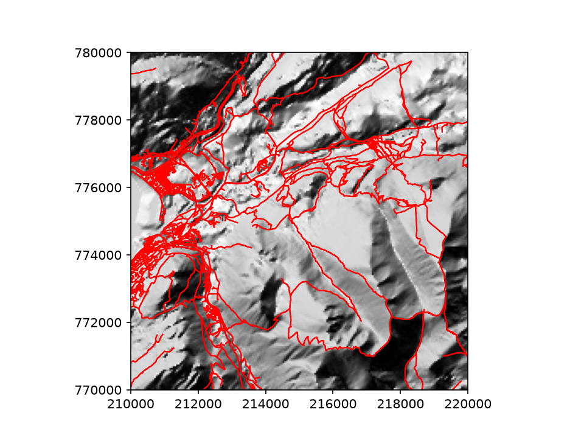

# Ben Nevis Geospatial Project

A simple project using mapping routes and terrain for paths around Ben Nevis. A first step project learning how to use geospatial data in Python. The elevation tile is British National Grid while osmnx returns lat/long.

It demonstrates how terrain data can be visualised using rasterio libraries, and how vectors for routes can be overlaid using osmnx. 

You will need:

- A conda environment
- osmnx
- numpy
- matplotlib
- rasterio
- geopandas

Data credit to Natural Earth, OS Terrain 50, OpenStreetMap contributors